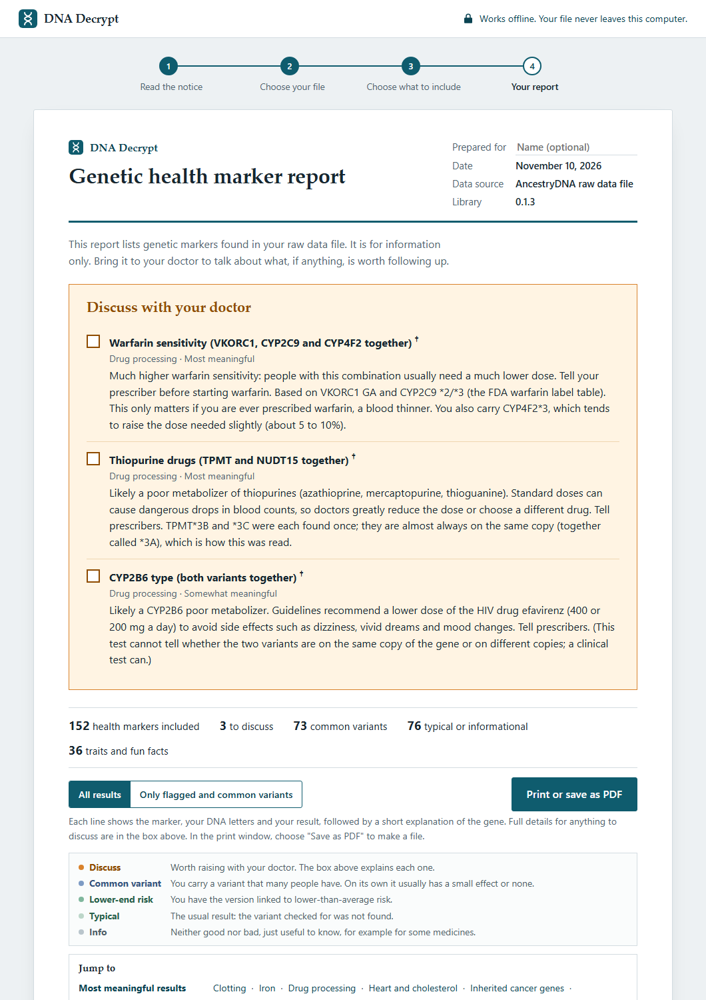

# DNA Decrypt (DNA Health Marker Report)

A fully offline program that reads an AncestryDNA or 23andMe raw data file (.txt, .csv or .zip) and produces a
plain-language, printable health marker report. Your DNA never leaves your computer.

DNA Decrypt is free. If it helped you, you can [buy me a coffee on Ko-fi](https://ko-fi.com/ordoleonum).

> **Important:** DNA Decrypt is for education only. It is not medical advice, a medical device or a diagnostic test.
> Consumer DNA chips miss most variants and can misread rare ones, and the interpretations have not been reviewed by
> a clinician. **Do not start, stop or change any medicine or treatment based on this report.** Confirm anything that
> matters with a clinical test, and talk to your doctor or a genetic counselor. Provided as is, with no warranty (see
> [LICENSE](LICENSE)).

*Sample report made from a made-up file, not a real person's DNA.*

## What you get
- **Discuss with your doctor:** a short checklist of any results worth raising, with what they mean.
- **Health results ranked by how much they can tell you:** most, somewhat and least meaningful, grouped by
  category (drug response, clotting, iron, heart, carrier status and more). One line per marker, in plain language.
- **Combined readings:** genes that are read together, such as your CYP2C19 drug-processing type, warfarin
  sensitivity, or two cystic fibrosis variants that together mean more than either alone.
- **Your choice on sensitive results:** inherited cancer genes, Alzheimer's, Parkinson's, carrier status and a
  strict ClinVar scan stay hidden unless you choose to see them.
- **Traits and fun facts:** eye color, caffeine, cilantro, earwax type, ancestry clues and more, kept separate from
  the health results.
- **A printable report:** about 5 to 17 pages depending on which sections you include, or save it as a PDF.

## How to use it
1. **Get your raw data file** from your DNA testing company (see below). Keep the .zip; you don't need to unzip it.
2. **Download DNA Decrypt** from the [Releases](../../releases) page: `DNA-Decrypt.exe` on Windows, or
   `DNA-Health-Report.html` on Mac or Linux (open it in a browser).
3. **Run it**, accept the notice, choose your file, pick which sensitive sections to include, and read or print your
   report. Nothing is installed and nothing is uploaded.

The .exe is signed with a free self-signed certificate (publisher "ordoleonum"), which shows the file has not been
changed since it was built. Windows does not recognize self-signed publishers, so SmartScreen may still warn on
first run: click "More info", then "Run anyway".

### Getting your raw data
- **AncestryDNA:** sign in, open the DNA section, go to your DNA settings and choose "Download DNA data". Ancestry
  emails you a link to a .zip file.
- **23andMe:** sign in, go to Settings, find the "23andMe Data" section and request your raw data download.

These steps change from time to time; if they don't match, search the company's help pages for "download raw DNA
data". This is the "raw data" file, not your ancestry results or a PDF report.

## FAQ
**Is my DNA uploaded anywhere?** No. The program blocks all network access and reads your file only on your
computer. When you close the window, the results are gone unless you saved or printed them.

**Does a clean report mean I'm healthy?** No. Consumer DNA chips read only a small part of your DNA and miss most
rare variants. A "typical" result does not rule out risk; only clinical testing can.

**What does the † mark mean?** That marker's interpretation hasn't been reviewed by an expert yet.

**Why are some results missing?** Each company's chip reads different positions. AncestryDNA files, for example,
don't include some drug-response markers (such as CYP2D6\*4 and VKORC1), so those results can't be shown.

**Does it work with 23andMe?** Yes. It has been tested with a real 23andMe file. Which markers appear depends on
your chip version. If something looks wrong, please open an issue (without attaching your DNA file).

**Is it really free?** Yes. There are no accounts, ads or paid features.

## How it keeps your data private
`DNA-Decrypt.exe` opens the app in its own Edge (or Chrome) window with a private profile, no extensions, and all
network traffic blocked. The page itself also has a Content-Security-Policy that forbids any network connection.
(`DNA-Health-Report.html` has the same page protection when opened in a browser on Mac or Linux.)

# For developers

Every push runs the engine tests and library checks automatically (`.github/workflows/tests.yml`).

## Status
Version 0.1.3 (November 2026).

| Area | State |
| --- | --- |
| Marker library | 154 markers, 31 combined readings, 8-variant strict ClinVar scan |
| Engine and tests | 42 automated tests pass (43 with a real raw-data file; checked with real AncestryDNA and 23andMe files) |
| Report | One offline HTML file; results ranked by meaningfulness, one line per marker with a plain-English explanation |
| Windows program | `DNA-Decrypt.exe`, built and self-signed by `build_exe.ps1`, published on the Releases page |
| AncestryDNA files | Tested with real .txt and .zip files |
| 23andMe files | Tested with a real file; markers under 23andMe's internal IDs are found by position (single-letter markers only) |
| Clinical review of interpretations | Not done; affected results are marked with a dagger in the report |

**What's in the library**
- 154 single markers (122 health, 32 traits) and 31 combined readings: 5 that need several positions (APOE, ABO,
  APOL1, NAT2, 3-site bitter taste) and 26 that read existing markers together (see below).
- Health results are ranked into three meaningfulness tiers: high 65, medium 49, low 34, plus the ClinVar scan (high).
- On an AncestryDNA file, 130 of 154 markers, 25 of 31 combined readings and 7 of 8 scan variants can be read. The
  rest need positions only on 23andMe chips (e.g. CYP2C9\*2/\*8/\*11, CYP2C19\*17, CYP2D6\*4/\*41, VKORC1, ADH1B,
  HBB sickle and E, Kell, APOE rs7412).
- Every marker and combined reading has a short plain-English explanation (`library/explanations.py`) shown after
  the result: what the gene does, what the variant changes, and the current understanding.

**Verification** with `tools/verify_library.py` (results in `library/verification_report.csv`)
- Every position (239 rows, including combined readings) exists in dbSNP GRCh37, and every single-letter
  marker's letters are forward-strand alleles.
- For rare variants, the variant is the dbSNP minor allele. For 5 common markers (SLC30A8, 8q24, SNCA, BTBD9, FOXO3)
  and 5 trait positions (ADORA2A, AR, the 3 bitter-taste sites) it is not; each matches the published risk/effect
  allele in the literature.
- Insertion/deletion letters follow AncestryDNA's D/I convention. BRCA1 185delAG is reported with D = normal (unlike
  its name).
- Combined readings were checked against CPIC tables, the FDA warfarin label (all 18 cells tested) and published
  studies.
- Sources are public and commercially usable (dbSNP, ClinVar, CPIC, FDA labels, peer-reviewed studies); SNPedia is
  not used.

**Latest additions,** chosen after a full re-check of both chips against guideline and population data. A candidate was added
only if it is well established (CPIC/DPWG guideline, ISBT blood group, or a large replicated effect), a single-letter
change, carried by at least about 0.5% of gene copies in some major population (rarer variants are where chips give
false positives), and on at least one of the two chips, with letters matching dbSNP and both real files:
DPYD c.2846A>T and HapB3, UGT1A1\*6, CYP2D6 \*10 (100C>T), \*17 and \*41, CYP2C9 \*5/\*8/\*11, CYP2C19 \*4/\*8,
rs12777823 (warfarin), CYP2B6\*18, CYP3A4\*22, CYP3A5\*6, BCHE atypical, G6PD Mediterranean, TTR V122I, PNPLA3
I148M, TM6SF2 E167K, hemoglobin E, MEFV V726A, G6PC R83C, Kell, Kidd, three non-European lactase-persistence
variants and OCA2 R419Q (eye color). Checked and left out: HLA-B\*58:01 and \*15:02 tags (wrong in most non-East-Asian
people), MT-RNR1 m.1555A>G, DPYD\*13, MEFV M680I, beta-thalassemia, FANCC, SMPD1, MCOLN1 and PCDH15 founder variants
(all too rare for reliable chip calls), and insertion/deletion variants.

## Meaningfulness tiers
Every health result has a `tier` (set in `TIER_HIGH` / `TIER_MEDIUM` / `TIER_LOW` in `library/build_library.py`;
carrier markers default to high; the build fails if any health result has no tier). The report groups health
results by tier first, then by category inside each tier; the doctor list is sorted by tier. Traits are not tiered.
- High (65 + ClinVar scan): large, well-established effects or guideline-backed drug advice (e.g. factor V Leiden,
  HFE C282Y, BRCA founders, carrier status, APOE, CYP2C19/CYP2C9/TPMT/DPYD/SLCO1B1, warfarin).
- Medium (49): real but moderate effects, proxy markers, or situational (e.g. Lp(a), CHEK2, celiac HLA, lactase,
  ALDH2, HLA proxies, CYP3A5, NAT2, macular degeneration).
- Low (34): small population-study effects or weak evidence (e.g. 9p21, TCF7L2, FTO, MC4R, AF markers, MTHFR, COMT,
  OPRM1, FOXO3, vitamin D, ABO).

## Combined readings (how genes work together)
Defined with `combined(...)` in `library/build_library.py`. Each reuses markers already in the library, so
letters and strand are shared (checked by `tools/check_library.py`), and every genotype combination, including
positions missing from the file ("?"), has a reading (stored once in `texts`, referenced by number in `rules`).
They show in their own sections with "Combined reading" under the name and keep their section's sensitivity.
- Two variants in one recessive gene: cystic fibrosis (5 CFTR variants; R117H worded separately because of poly-T),
  sickle cell + hemoglobin C and E (HbSC, HbSE), familial Mediterranean fever, Tay-Sachs (late-onset with G269S), MUTYH (MAP), alpha-1 antitrypsin (SZ).
  Array data cannot tell cis from trans; texts say so and ask for clinical confirmation.
- Clotting (factor V Leiden + prothrombin, 5-20x from Emmerich 2001 and the 2024 FinnGen/UK Biobank study), HFE type
  (C282Y/H63D etc., Danish 6,020-men study), MTHFR compound heterozygote (ACMG 2013: do not act on it).
- Drugs: CYP2C19 type, CYP2C9, CYP2D6 and DPYD activity scores, CYP2B6 (efavirenz), CYP3A5 (tacrolimus) and UGT1A1
  types (CPIC tables; CYP2D6 cannot see whole-gene deletions or duplications), warfarin sensitivity (all 18 cells of the FDA label
  table, tested; CYP4F2\*3 adds 5-10%), thiopurines (TPMT \*3B+\*3C read as \*3A; CPIC 2025 compound intermediate with NUDT15).
- Celiac (neither DQ2.5 nor DQ8 = lower risk; DQ2.2 not checked; missing data gives no reassurance), macular
  degeneration (CFH + ARMS2), alcohol (ALDH2 + ADH1B, Lee 2008), lactose digestion (4 persistence variants).
- Traits: red hair (4 MC1R R alleles), hair loss (20p11 + AR, Richards 2008), caffeine (CYP1A2 + ADORA2A),
  vitamin A from beta-carotene (BCMO1, Leung 2009).
- Need markers not on the AncestryDNA chip: warfarin (VKORC1), alcohol (ADH1B), hair loss (AR), caffeine (ADORA2A),
  BCMO1 (R267S). Not combined on purpose: the two 9p21 markers (same signal) and the two LPA markers.

## Wider ClinVar scan (strict, exact matches only)
A sensitive, opt-in section that checks the file against ClinVar, built so false positives are as close to zero as
possible. `tools/build_clinvar_scan.py <clinvar.vcf.gz>` writes `library/clinvar_scan.json`; `build_library.py`
merges it into `markers.json` as `clinvarScan` (dropping anything already covered by a library marker).
- Source: ClinVar GRCh37 VCF from NCBI (public data, no use restrictions), snapshot 2026-11-01, checksum verified.
- Kept only if: exactly "Pathogenic" (not likely pathogenic, not conflicting), 2+ stars; a single-letter change with
  one rsID on chr 1-22 or X; not A/T or C/G; at least 1 in 1,000 in EVERY population source with 2+ sources reporting
  (chips misread rarer variants: Weedon et al., BMJ 2021); not on the artifact list (NF1 rs200962248, CYP21A2 rs6445,
  both hard-to-read sites). Result: 8 of 4,616,207 ClinVar records (7 are on the AncestryDNA chip).
- Engine: reports a variant only if rsID, chromosome, GRCh37 position and every letter match exactly (no strand
  flipping; AncestryDNA chromosome 23 = X). Two copies of a variant rarer than 1% are withheld as a likely chip error.
  Variants not in the file are not listed. Findings go in "Discuss with your doctor" when the section is chosen.
- Refresh: download the new VCF and its .md5, run the two scripts, then `build_exe.ps1`. Variants without a
  hand-written plain-language note (`NOTES` in the script) get a generic text.

## Traits, ancestry clues and fun facts
32 trait markers plus the 3-site bitter-taste composite and 4 combined trait readings, in four categories with
`"group": "traits"` (Looks and body, Food and drink, Ancestry clues, Fun facts). They appear in a separate section
after the health results, are never counted in the health summary or the "Discuss with your doctor" list, are
always shown (not affected by the results filter), and every result is informational. Texts are written for a
general reader. Add more with `trait(...)` in `library/build_library.py`.

## Not included, and why
- GJB2 167delT and Bloom syndrome (blmAsh): their dbSNP records do not match the variant cleanly, so letters could be misread.
- Maternal haplogroup: the AncestryDNA chip's 195 mtDNA positions are mostly disease sites and lack the main
  haplogroup markers (e.g. 2706, 7028, the 16xxx control region), so a call would be unreliable.
- Paternal (Y) haplogroup: the file has ~1,600 Y positions, but turning rsIDs into named haplogroups needs a
  reference index (ISOGG, YBrowse) whose terms are non-commercial.
- Not suitable for array data or responsible reporting: Huntington's, fragile X, SMA, alpha-thalassemia, Rh type,
  polygenic risk scores, ancestry percentages (would need a large reference panel), "warrior gene", personality,
  intelligence, sexual orientation, diet-by-DNA plans.

## Design decisions
- Sensitive categories are hidden until the user opts in: inherited cancer genes, Alzheimer's, Parkinson's, carrier status, and the wider ClinVar scan.
- Alleles are forward-strand. The engine flips non-palindromic genotypes reported on the opposite strand.
- Insertion/deletion markers use the vendors' D/I letters.
- 23andMe lists some markers under internal "i" IDs instead of rsIDs. For 23andMe files only, a single-letter marker
  missing by rsID is read from a row at the exact same GRCh37 position (`library/positions.json`), but only if every
  letter is one of the marker's two expected letters (no strand flipping) and all rows at that position agree. The
  result's note names the 23andMe ID it came from. AncestryDNA files never use position matching.
- Insertion/deletion markers are never matched by position. 23andMe does not publish which of its D/I letters is the
  usual one for each marker, and at least one (BRCA1 185delAG) is reported to be the reverse of AncestryDNA's. So on
  23andMe files CHEK2 1100delC, BRCA1 185delAG, HEXA 1278insTATC, CFTR F508del and GJB2 35delG are not read, and
  insertion/deletion results that are read by rsID carry a note to confirm them clinically.
- Markers whose strand, notation or effect direction was inferred have `verify.level = "inferred"` and are marked with
  a dagger in the report (`CONFIG.showUnverifiedFlag` in the app).
- Not covered on purpose: Rh type, haplogroups/ancestry, Lynch/CDH1 genes, most BRCA variants (see `notCovered` in the library).

## Report layout
One line per marker (traits too): name, DNA letters, result label and the opening sentence of the result (two
sentences if the first is very short). Under it, spanning the line, a plain-English explanation of the gene and the
marker's note in small italics. A key explains the result labels, "Jump to" links lead to each section, and a floating
"Top" button returns to the top. The full text of every "discuss" result is in the doctor list at the top. With every
section on, a made-up sample prints about 17 letter pages.
Measure: `python tools/make_sample_file.py <out.txt>`, `tools/test_server.ps1 -RealFile <out.txt> -SaveTo <report.html>`,
open `http://127.0.0.1:8765/engine/tests/print_harness.html` (add `?preview=1` to see the print layout on screen),
then `tools/count_pages.ps1 -Html <report.html> -Out <report.pdf>`.

## Build
1. If you changed markers: `python library/build_library.py` (needs Python) to regenerate `markers.json` and the review CSV.
2. `powershell -ExecutionPolicy Bypass -File build_exe.ps1` (Windows) assembles `dist/DNA-Health-Report.html` from
   the source files below and compiles `dist/DNA-Decrypt.exe` with the C# compiler built into Windows.
3. To release: create a new GitHub release and attach both files from `dist/`. The `dist/` folder is not kept in git.

Signing: `tools/make_signing_cert.ps1` creates (once) a free self-signed code-signing certificate for "CN=ordoleonum"
in your Windows user certificate store and exports its public part to `dist/ordoleonum-codesign.cer`. From then on
`build_exe.ps1` signs and timestamps the .exe automatically. This proves the file is unchanged since signing; it does
not remove the SmartScreen warning (that needs a paid code-signing certificate). The private key stays in
your Windows account and cannot be exported, so builds from another computer are unsigned.

The app's source is in `app/`: `page.html` (layout, with `{{STYLES}}`, `{{LIBRARY}}`, `{{ENGINE}}`, `{{ZIP}}` and
`{{APP}}` placeholders), `styles.css`, `app.js` (interface; app settings are in its `CONFIG` block) and `zip.js`
(zip reader). Edit these, never the files in `dist/`.

## Tests
- With Node: `node engine/tests/run_tests.js [path to raw data file]`
- Without Node: `powershell -ExecutionPolicy Bypass -File tools/test_server.ps1 -RealFile <raw data file>` then open
  `http://127.0.0.1:8765/engine/tests/run_tests.html` (add `?real=/real` to include the real-file test). Local only.
- `node engine/cli.js <raw data file> [--reveal=all]` prints a text summary.
- `python tools/check_library.py [raw data file]` validates the library.
- `python tools/verify_library.py [raw data file]` re-runs the database check (needs internet; sends only rsIDs).
  If you pass a raw data file, the report it writes contains that file's genotypes: don't commit or share it.

## Files
- `library/build_library.py`  edit this, then run it to regenerate the JSON and the review CSV
- `library/markers.json`      what the program reads
- `library/positions.json`    GRCh37 positions of single-letter markers, for 23andMe internal-ID matching
- `library/library_review.csv` one row per marker, for review
- `tools/check_library.py`    validates the library and replays a real raw-data file against it
- `tools/test_server.ps1`     local-only web server for running tests in a browser
- `tools/verify_library.py`   compares the library with dbSNP/ClinVar (via Ensembl GRCh37)
- `library/verification_report.csv` its output, one row per marker position
- `tools/build_clinvar_scan.py` builds `library/clinvar_scan.json` (the strict ClinVar scan list) from ClinVar's VCF
- `tools/make_sample_file.py`, `tools/count_pages.ps1`, `engine/tests/print_harness.html`  made-up sample file and
  printed-page count for layout checks
- `engine/engine.js`          the engine (browser + Node, no dependencies, no network)
- `engine/cli.js`             quick command-line runner
- `engine/tests/run_tests.js` automated tests (`run_tests.html` runs them in a browser)
- `launcher/Launcher.cs`, `launcher/app.ico`  the Windows launcher source and icon
- `library/explanations.py`   the plain-English explanation for every marker and combined reading
- `tools/make_signing_cert.ps1` creates the self-signed code-signing certificate used by `build_exe.ps1`
- `app/page.html`, `app/styles.css`, `app/app.js`, `app/zip.js`  the app's source (layout, styles, interface, zip reader)
- `build_exe.ps1`             builds `dist/DNA-Health-Report.html` (single-file app) and `dist/DNA-Decrypt.exe` (not in git)
- `.github/workflows/tests.yml` runs the tests on GitHub on every push
- `docs/sample-report.png`    README screenshot, made from `tools/make_sample_file.py` output (made-up genotypes)
- `.github/FUNDING.yml`       Ko-fi link for the repository's Sponsor button
- `.github/ISSUE_TEMPLATE/`   bug report form that reminds people never to attach DNA files

## License
DNA Decrypt is licensed under the [PolyForm Noncommercial License 1.0.0](LICENSE): free to use, share and modify for any noncommercial purpose. Commercial use needs separate permission from the author.

Required Notice: Copyright ordoleonum (https://github.com/ordoleonum)
